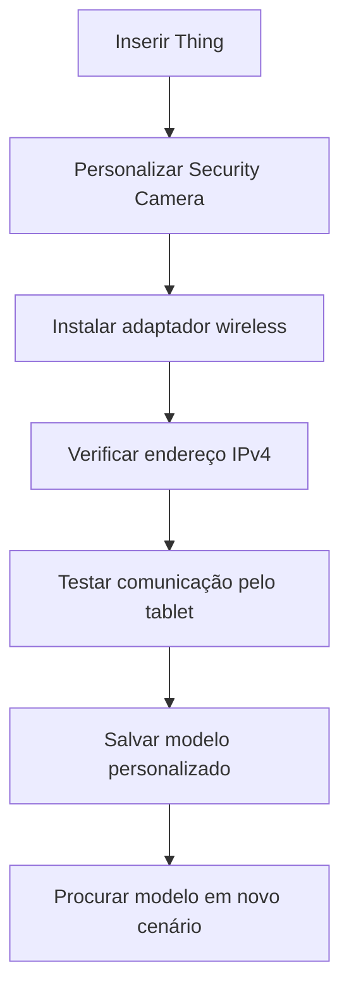

# Criação de Dispositivo IoT

## Visão geral

Neste laboratório educacional, utilizei o **Cisco Packet Tracer** para personalizar um dispositivo IoT genérico (`Thing`) e como uma câmera de segurança (`Security Camera`). Configurei sua interface wireless, examinei sua conexão à rede e pratiquei como salvar o dispositivo como um modelo reutilizável.

O exercício ajuda a entender como dispositivos inteligentes podem ser identificados, conectados e organizados em uma rede simulada.

---

## Objetivos

- Personalizar um dispositivo IoT genérico.
- Instalar um adaptador de rede wireless.
- Verificar o endereçamento IPv4 e a comunicação com outro dispositivo.
- Salvar a configuração como modelo reutilizável.

---

## Etapas do laboratório

1. **Criar o dispositivo:** inserir um componente `Thing` na área de trabalho e alterar o nome de exibição para `Security Camera`.
2. **Personalizar:** no `Thing Editor`, configurar `Component Name`, `Slot Mapping` como `Digital` no `Slot 1` e adicionar a imagem da câmera.
3. **Configurar a conexão:** na aba `I/O Config`, selecionar o adaptador `PT-IOT-NM-1W-AC` e examinar a interface `Wireless0`.
4. **Testar a comunicação:** utilizar o terminal do tablet para enviar um `ping` ao endereço IPv4 atribuído à câmera.
5. **Salvar como modelo:** acessar `Tools > Custom Device Dialog`, selecionar a câmera, marcar `Home` e utilizar `Add` e `Save`.
6. **Conferir o catálogo:** abrir um cenário novo e procurar a câmera personalizada em `End Devices > Home`.

---

## Fluxograma do processo

---

## Onde esse conhecimento pode ser aplicado?

**Cenário fictício: câmeras para uma pequena loja**

Uma loja quer instalar câmeras de segurança em diferentes ambientes. Durante a preparação, a equipe percebe que configurar cada equipamento separadamente pode consumir tempo e gerar diferenças entre eles.

Um profissional de TI pode utilizar um modelo padronizado como referência para preparar os dispositivos e testar se cada um responde pela rede antes de colocár em uso.

**Relação com o laboratório:** a atividade demonstra a personalização de um dispositivo IoT, a verificação da comunicação e a criação de um modelo reutilizável em um simulador. Na prática, uma instalação real também exigiria cuidados com senhas, proteção da rede e testes de funcionamento das câmeras.

---

## Configurações por dispositivo

### Dispositivo IoT: Security Camera

| Parâmetro | Configuração descrita |
|---|---|
| Componente inicial | Thing |
| Display Name | Security Camera |
| Component Name | Security Camera |
| Slot Mapping | Digital, Slot 1 |
| Imagem do dispositivo | Ícone personalizado de câmera |
| Network Adapter | PT-IOT-NM-1W-AC |
| Interface de rede | Wireless0 |
| Endereçamento IPv4 | Dinâmico |
| Sub-rede informada | 192.168.25.0/24 |

---

### Tablet de testes

| Parâmetro | Informação descrita |
|---|---|
| Função | Testar a comunicação com a câmera |
| Ferramenta | Desktop > Command Prompt |
| Comando | `ping` para o endereço IP da câmera |
| Endereço IP do tablet | Não informado |

---

### Modelo reutilizável

| Parâmetro | Configuração descrita |
|---|---|
| Ferramenta | Tools > Custom Device Dialog |
| Dispositivo selecionado | Security Camera |
| Categoria | Home |
| Ação | Add e Save |
| Verificação prevista | Encontrar o dispositivo em End Devices > Home em um novo cenário |

---

## Conhecimentos adquiridos

- Entendi como personalizar a identificação e a aparência de um dispositivo IoT no Packet Tracer.
- Pratiquei a escolha de um adaptador wireless e a consulta às configurações de rede.
- Reforcei o uso do `ping` para investigar conectividade entre dispositivos.
- Aprendi como modelos reutilizáveis ajudam a manter configurações consistentes em simulações.

Esses conceitos se relacionam com atividades de **Suporte de TI**, **Redes** e **Cybersecurity**, especialmente na identificação de dispositivos e na investigação de problemas de conexão.

---

## Entendendo os termos técnicos

| Termo | O que significa? |
|---|---|
| IoT | Dispositivos conectados à rede, como câmeras e sensores inteligentes. |
| Wireless | Comunicação por rede sem fio. |
| Adaptador de rede | Componente que permite conectar um equipamento à rede. |
| Endereço IP | Número que identifica um dispositivo na rede. |
| IPv4 | Formato de endereço IP usado no exercício. |
| Ping | Teste simples para verificar se outro dispositivo responde pela rede. |
| Sub-rede | Grupo de endereços de uma mesma rede. |
| Template | Modelo salvo para ser utilizado novamente sem repetir toda a configuração. |
